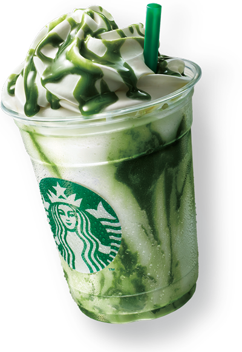

[← Voltar ao perfil](https://github.com/yanxc76)

# Starbucks · Landing page de estudo

**HTML · CSS · JavaScript · Manipulação do DOM**

Uma interface de estudo inspirada na identidade visual da Starbucks, com seleção de bebidas e troca dinâmica da imagem do produto e da cor de destaque.

<p align="center"></p>

## O que o projeto demonstra

- Estrutura de página com HTML e organização visual com CSS.
- Seleção de três produtos por miniaturas.
- Atualização da imagem e da cor de fundo com JavaScript.
- Inclusão de um webchat via Botpress no HTML.

## Executar localmente

Clone o repositório e abra `index.html` no navegador. Não há etapa de build nem dependências npm.

```bash
git clone https://github.com/yanxc76/StarBucks-projeto.git
cd StarBucks-projeto
```

Para servir os arquivos por HTTP, uma opção com Python é:

```bash
python3 -m http.server 8000
```

Acesse **http://localhost:8000**. As fontes do Google e o webchat dependem de serviços externos.

## Estrutura

| Arquivo | Responsabilidade |
| --- | --- |
| [index.html](index.html) | Conteúdo, produtos e integração do webchat |
| [styles.css](styles.css) | Layout, cores e apresentação |
| [scripts.js](scripts.js) | Funções `mudarCor` e `trocaImagem` |
| [img/](img/) | Imagens e elementos visuais |

## Escopo

O foco é a interação visual em uma página estática. O botão principal não implementa um checkout, e a folha de estilos ainda não contém regras específicas para telas pequenas.

Projeto educacional inspirado em uma marca existente, sem vínculo oficial com a Starbucks. A página original identifica o exercício como “StarBacks DevClub”.
